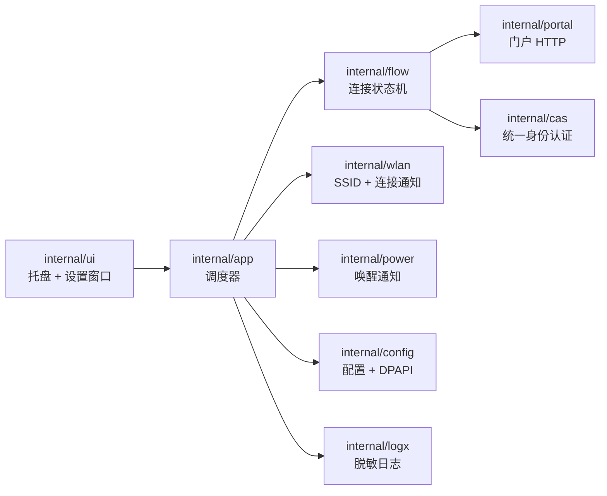
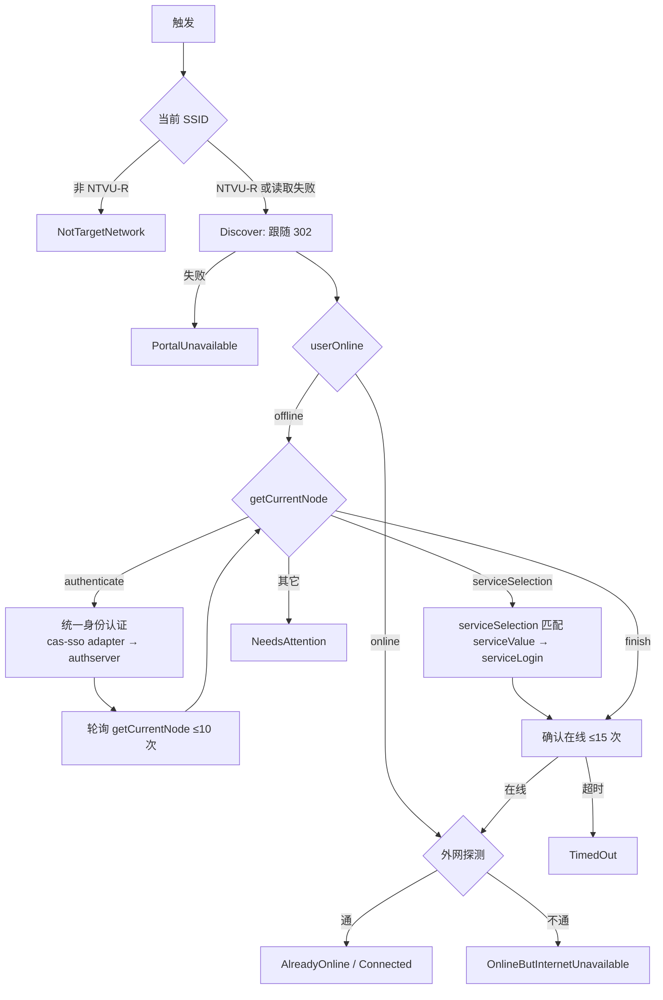

# 校园网自动连接（CampusConnect）设计

日期：2026-10-08
状态：设计已逐节认可；2026-10-08 修订第 2.4–2.6 节（统一身份认证实际走 `cas-sso` 委托 `authserver`），待用户审阅本文档

## 1. 目标与范围

在 Windows 上常驻托盘，连接 `NTVU-R` 时自动完成南通职业大学校园网门户认证（统一身份认证学号密码 → 运营商选择 → 在线确认），掉线自动重连。

- 单个 `CampusConnect.exe`，不依赖浏览器、Node、.NET 或 PowerShell 运行时。
- 纯 HTTP 实现门户协议；不启动浏览器。
- 非目标：验证码识别、短信/扫码/企业微信等其它认证方式、访客流程、多账号、跨平台。

## 2. 已核实的门户协议（2026-10-08 实测）

门户为锐捷 SAM/ePortal + 锐捷 CAS（`/cas-sso`，pac4j 委托认证）+ 学校统一身份认证（`https://authserver.ntvu.edu.cn/authserver`）。以下来自实际请求与公开前端 bundle（`/portal/7243.419d7f3f5d4cfcb769b0.js`、`/portal/8246.a50830a312a6505042af.js`、`/portal/2972.7b7b34964e0336a8a332.js`、`/portal/6066.cd34009bb31fa414a15a.js`、`/sso-public/cas-login-new/main.js`、`/authserver/cusTheme20251022/static/common/encrypt.js`、`/authserver/cusTheme20251022/customStatic/web/js/login.js`）。

### 2.1 会话发现

```
GET https://nap.ntvu.edu.cn/                → 302 Location: https://nap.ntvu.edu.cn/eportal/redirect.jsp
GET https://nap.ntvu.edu.cn/eportal/redirect.jsp
                                            → 302 Location: http://nap.ntvu.edu.cn/portal/portal-main?sessionId=<12hex>&userIp=…&userMac=…&ssid=Ruijie&nasIp=…&customPageId=4&…&userOnline=true|false&…
```

未认证（已下线）时 2026-10-13 实测，`redirect.jsp` 改为把客户端送往 NAS 拦截地址，多两跳：

```
GET https://nap.ntvu.edu.cn/eportal/redirect.jsp
                                            → 302 Location: http://123.123.123.123（无路径）
GET http://123.123.123.123/                 → 200，正文仅 <script>top.self.location.href='https://nap.ntvu.edu.cn/eportal/index.jsp?wlanuserip=…&wlanacname=NAS&ssid=Ruijie&nasip=…&mac=…&t=wireless-v2-plain&url=http://123.123.123.123/'</script>
GET https://nap.ntvu.edu.cn/eportal/index.jsp?<同上查询>
                                            → 302 Location: http://nap.ntvu.edu.cn/portal/portal-main?sessionId=…（无 userOnline 参数）
```

拦截页只取脚本中的 URL：必须为 `nap.ntvu.edu.cn` 的 `/eportal/index.jsp`，按 HTTPS 重建后请求，否则 `PortalChanged`。不请求 `portal-main` 本身，只解析 Location 的查询参数：`sessionId`、`userIp`、`userMac`、`ssid`、`nasIp`、`customPageId`、`userOnline`。每次连接都重新发现，不缓存 sessionId。

### 2.2 只读状态接口（JSON，`Content-Type: application/json;charset=UTF-8`）

| 接口 | 请求 | 判定 |
|---|---|---|
| `POST /eportal/network/userOnline` | `{"sessionId":…}` | `code==200 && data.online==true` 为在线 |
| `GET /eportal/adaptor/getOnlineUserInfo?sessionId=…` | — | `code==200 && data.onlineUser` 非空为在线；`data.portalOnlineUserInfo.service` 为当前运营商值 |
| `POST /eportal/workFlow/getCurrentNode` | `{"sessionId":…,"flowKey":"portal_auth"}` | `data.currentNodePath`，已见值 `finish`；前端路由还包含 `authenticate`、`serviceSelection` 等 |
| `POST /eportal/network/serviceSelection` | `{"sessionId":…}` | `data` 为 `[{key,value}]`，实测：校园网=`PUBLIC`、中国电信=`CTCC`、中国联通=`CUCC`、中国移动=`CMCC` |

### 2.3 写操作接口

- `POST /eportal/network/serviceLogin` `{"sessionId":…,"service":"CUCC"}`：仅当 `code==200 && data.authResult=="success"` 视为提交成功，随后前端调用 `getCurrentNode` 取下一节点；`authResult` 不为 `success` 时取 `data.authMessage` 作为错误信息；`code!=200` 时取 `message`（`/portal/2972…js` `submitForm`）。

### 2.4 统一身份认证（`cas-sso` 委托 `authserver`）

门户认证页的 iframe 加载 `/cas-sso/login`。带 `flowSessionId` 时页面 `current-login-type=adapter`，内联脚本按 `ruleList`（`adapter`，`isRedirect=true`）向父页面发 `jumpRedirectFunction`，门户随即在顶层打开 `clientredirect`；账号密码表单实际在 `authserver`。`cas-sso` 自身的 `UsernamePassword` 表单在门户模式下不被使用，本程序不向其提交凭据。同代锐捷门户的开源客户端（`Youwenqwq/ysu-sdk`，`client_name=sidadapter`）同样走 `clientredirect`，可作旁证。

第 1–4 步 2026-10-08 实测（未提交凭据）：

1. `GET https://nap.ntvu.edu.cn/cas-sso/login?flowSessionId=<sessionId>&customPageId=<id>&preview=false&appType=normal&language=zh-CN&timer=<毫秒时间戳>&nasIp=…&userIp=…&ssid=…&nodeMac=<userMac>`（参数与门户 `PcAuthenticate.ngOnInit` 一致；`nodeMac` 取跳转参数 `userMac` 属 [推断]）→ 200，下发 `SESSION`（`Path=/cas-sso/`）。页面隐藏字段 `current-login-type` 必须为 `adapter`，否则 `PortalChanged`。
2. `GET https://nap.ntvu.edu.cn/cas-sso/clientredirect?client_name=adapter&accept-language=zh-CN&service=<门户认证页 URL>` → 302，下发 `PAC4JDELSESSION`（`Path=/cas-sso`）。Location 必须为 `https://authserver.ntvu.edu.cn/authserver/login?service=<https://nap.ntvu.edu.cn/cas-sso/login?client_name=adapter&accept-language=zh-CN&delegatedclientid=…>`，否则 `PortalChanged`。`service` 取 `https://nap.ntvu.edu.cn/portal/entry/pc/authenticate`：浏览器中为当时的 `window.location.href`，确切形式属 [推断]。
3. `GET` 第 2 步的 Location → 200，下发 `route`、`JSESSIONID`（`Path=/authserver`）。解析表单 `#pwdFromId`：`execution`、`lt`（空）、`_eventId=submit`、`cllt=userNameLogin`、`dllt=generalLogin`，以及无 `name` 的 `#pwdEncryptSalt`（16 字符）。缺任一字段 → `PortalChanged`。页面变量 `captchaSwitch="1"`（图片验证码）、`_badCredentialsCount="3"`。
4. `GET https://authserver.ntvu.edu.cn/authserver/checkNeedCaptcha.htl?username=<学号>&_=<毫秒时间戳>` → `{"isNeed":false}`。`isNeed` 为真 → `CaptchaRequired`；`isNeedActive` 为真 → `NeedsAttention`（账号待激活）。
5. `POST` 第 3 步同一 URL（`/authserver/login?service=…`），`application/x-www-form-urlencoded`：`username=<学号>`、`password=<加密密码>`、`captcha=`、`_eventId=submit`、`cllt=userNameLogin`、`dllt=generalLogin`、`lt=`、`execution=<值>`。明文框 `passwordText` 提交前被禁用，不发送。
   加密（`encrypt.js` `encryptPassword`）：`base64(AES-CBC-PKCS7(key=UTF8(salt.trim()), iv=UTF8(16 位随机串), 明文=64 位随机串 + 密码))`，随机字符取自 `ABCDEFGHJKMNPQRSTWXYZabcdefhijkmnprstwxyz2345678`。盐为 16 字节，即 AES-128。
6. 第 5 步结果（不自动跟随）：
   - 302 且 Location 为 `https://nap.ntvu.edu.cn/cas-sso/login?…`（含 `ticket` 参数）→ 继续第 7 步。
   - 200 → 失败，取 `#showErrorTip` 文本作为提示，归为 `AuthenticationRejected`。随即暂停自动登录，避免连续 3 次错误后出现验证码或锁定。
   - 其它 Location（如改密、完善信息）→ `NeedsAttention`。
7. `GET` 回调 URL：`cas-sso` 用 ticket 向 `authserver` 的 `serviceValidate` 校验。逐跳检查 Location：仍在 `https://nap.ntvu.edu.cn/cas-sso/` 下则继续，最多 3 跳；离开 `/cas-sso`（返回门户 `service`）即停止，不访问门户 SPA；指向其它 host → `PortalChanged`；指向 `/cas-sso/client/bind/…` → `NeedsAttention`（第三方账号未绑定）。若回调页含 `login-error-code`：`1030027`/`1030031`/`1410040`/`1410041` → `AuthenticationRejected`，`1030028` → `AccountLocked`，`1330001` → `AccountRisk`，`1320007`/`1320010` → `CaptchaRequired`，其它 → `NeedsAttention`。
8. 之后以 `getCurrentNode` 是否离开 `authenticate` 为准（第 4 节轮询）。

### 2.5 请求白名单

HTTP 客户端只允许以下请求，其它一律在发出前拒绝并返回 `InternalError`：

- `nap.ntvu.edu.cn`：`GET /`、`GET /eportal/redirect.jsp`、`GET /eportal/index.jsp`；`POST /eportal/network/userOnline`、`GET /eportal/adaptor/getOnlineUserInfo`、`POST /eportal/workFlow/getCurrentNode`、`POST /eportal/network/serviceSelection`、`POST /eportal/network/serviceLogin`；`GET /cas-sso/login`、`GET /cas-sso/clientredirect`（仅 `client_name=adapter`）
- `GET http://123.123.123.123/`（NAS 拦截页，无查询参数）
- `authserver.ntvu.edu.cn`：`GET`/`POST /authserver/login`、`GET /authserver/checkNeedCaptcha.htl`
- `GET http://www.msftconnecttest.com/connecttest.txt`

白名单之外包括 bundle 中出现的全部注销/下线接口：`/eportal/network/offline`、`/eportal/auth/json/logout`、`/portal/portalAuthen/logout`、`/portal/cas/getLogout`、`/cas-sso/logout`、`/authserver/logout`、`/eportal/adaptor/kick-offline/batch`、`/eportal/workFlow/updateUserSession` 等。前端 `checkOnlineUser()` 的风险在于其失败分支会跳转注销，不在查询接口本身；本程序不实现任何注销分支，在线查询失败只视为“状态未知”。

### 2.6 下线后实测（2026-10-13）

手动下线后用真实凭据完成 3 次登录（立即连接与定时触发各有），脱敏日志链路一致：`redirect.jsp` → 拦截页 `123.123.123.123/` 200 → `index.jsp` 302 → 节点 `authenticate` → `cas-sso/login` 200 → `clientredirect` 302 → `authserver/login` GET 200 → `checkNeedCaptcha.htl` 200 → `authserver/login` POST 302（第 5 步成功）→ `cas-sso/login`（带 ticket）302，一跳即离开 `/cas-sso` → 约 1 秒后节点 `serviceSelection` → `serviceLogin` 200 → `Connected`。认证结果确由 `cas-sso` 在服务端推进门户流程，无需额外接口；白名单无需再改。

## 3. 架构

单个 Go 程序，WSL 交叉编译 `GOOS=windows GOARCH=amd64`，`-ldflags "-H=windowsgui"`，`go-winres` 嵌入清单（DPI 感知、Common Controls v6）与图标。



| 包 | 职责 |
|---|---|
| `internal/portal` | 门户 HTTP 客户端：`Discover`、`UserOnline`、`OnlineUserInfo`、`CurrentNode`、`Services`、`ServiceLogin`；Cookie jar；请求白名单（第 2.5 节） |
| `internal/cas` | `cas-sso` 页面解析与 `clientredirect`、`authserver` 表单解析、验证码预检、AES-CBC 密码加密、表单提交、回调跳转与错误映射 |
| `internal/flow` | `Connect(ctx) Result`，只依赖接口，可用 `httptest` 离线测试 |
| `internal/wlan` | `wlanapi.dll`：`WlanQueryInterface` 读当前 SSID；`WlanRegisterNotification` 订阅 ACM 连接完成 |
| `internal/power` | `PowerRegisterSuspendResumeNotification` 回调式订阅唤醒，不依赖窗口消息 |
| `internal/config` | 配置读写；密码用 `CryptProtectData`（当前用户范围）加密后 base64 存储 |
| `internal/logx` | 日志文件、1 MB 轮转保留 1 份、脱敏 |
| `internal/app` | 单实例、触发合并、退避、状态广播 |
| `internal/ui` | `github.com/tailscale/walk`：托盘图标、菜单、气泡、设置对话框 |

依赖（固定版本，写入 `go.mod`）：`github.com/tailscale/walk`、`github.com/tailscale/win`、`golang.org/x/sys`；构建工具 `github.com/tc-hib/go-winres`。

文件位置：
- 配置 `%APPDATA%\CampusConnect\config.json`
- 日志 `%LOCALAPPDATA%\CampusConnect\campus.log`
- 单实例互斥量 `Local\CampusConnect`
- 开机自启 `HKCU\Software\Microsoft\Windows\CurrentVersion\Run\CampusConnect`（设置中勾选）

配置结构：

```json
{
  "schemaVersion": 1,
  "username": "学号",
  "passwordProtected": "<DPAPI 密文 base64>",
  "serviceValue": "CUCC",
  "serviceLabel": "中国联通",
  "ssid": "NTVU-R",
  "autostart": true
}
```

## 4. 连接流程



规则：
- SSID 用 WLAN API 读取，不使用 `NetConnectionProfile.Name`（旧版正因此在 Name 变为 `NTVU-R 2` 后失效）。SSID 读取失败（如位置权限被拒）时记录警告并继续 Discover：只有拿到 `nap.ntvu.edu.cn` 的 `portal-main` 跳转与 sessionId 才算校园网；此时 Discover 失败归为 `NetworkNotReady`。
- 跟随 302 手动进行，逐跳校验：Discover 只接受 host 精确等于 `nap.ntvu.edu.cn` 的 Location（scheme 为 http 或 https），或恰为 `http://123.123.123.123[/]` 的拦截地址（第 2.1 节），最多 4 跳；统一身份认证各跳按第 2.4 节校验；不符视为 `PortalChanged`。`portal-main` 的 Location 虽为 http，但只解析参数不访问；此后门户与认证请求一律走 HTTPS（2026-10-08 实测 `userOnline`、`/cas-sso/login`、`/authserver/login` 均可用），凭据不经明文 HTTP 传输。
- 节点循环最多 4 轮；统一身份认证（第 2.4 节第 5 步）每次 Connect 最多提交 1 次；`serviceLogin` 每次 Connect 最多提交 1 次。
- `serviceSelection` 中找不到已保存的 `serviceValue` → `ServiceNotFound`。
- 外网探测：`GET http://www.msftconnecttest.com/connecttest.txt`，正文等于 `Microsoft Connect Test`。
- HTTP：TLS 校验开启，`Proxy=nil`，单请求超时 7 秒，单次 Connect 总超时 60 秒；User-Agent 使用常见桌面浏览器字符串。

## 5. 触发与调度

触发源：启动、WLAN 连接完成通知（SSID 为目标时）、系统唤醒、每 60 秒巡检、托盘“立即连接”。

- 同一时刻只运行一个 Connect；运行期间到达的触发合并为一次后续执行。
- 巡检只在当前 SSID 为目标网络（或读取失败）时进行；巡检发现离线即走完整 Connect。
- 退避：结果为 `NetworkNotReady`/`PortalUnavailable`/`TimedOut`/`PortalChanged`/`InternalError` 时，下一次自动 Connect 间隔依次为 1、2、5 分钟（之后保持 5 分钟）；成功或在线后清零。退避期间巡检仍检测在线状态，但不提交登录。
- 暂停自动登录直到用户在设置中修改并保存：`AuthenticationRejected`（`authserver` 返回错误页，或回调错误码 1030027/1030031/1410040/1410041）、`AccountLocked`（1030028）、`AccountRisk`（1330001）、`CaptchaRequired`、`ServiceNotFound`、`ConfigurationRequired`。“立即连接”可手动绕过暂停。
- 唤醒与 WLAN 连接通知后延迟 3 秒再执行，等待 DHCP。

## 6. 结果状态

| 状态 | 含义 | 托盘 |
|---|---|---|
| `Connected` | 本次完成认证且外网通 | 绿 |
| `AlreadyOnline` | 已在线且外网通 | 绿 |
| `OnlineButInternetUnavailable` | 门户在线但外网探测失败 | 黄 |
| `NotTargetNetwork` | 未连接 NTVU-R | 灰 |
| `NetworkNotReady` / `PortalUnavailable` / `TimedOut` | 网络或门户暂时不可用 | 黄 |
| `ConfigurationRequired` | 未设置学号/密码 | 红 |
| `AuthenticationRejected` / `AccountLocked` / `AccountRisk` / `CaptchaRequired` | 统一身份认证拒绝 | 红 |
| `ServiceNotFound` | 运营商不在列表中 | 红 |
| `NeedsAttention` | 出现未支持的流程节点、跳转或未知认证错误码 | 红 |
| `PortalChanged` / `InternalError` | 门户结构变化或程序错误 | 红 |

## 7. 界面

托盘：
- 图标三色（绿/黄/红）加灰色，悬停显示状态与最后检查时间。
- 状态变化时弹气泡；同一类问题只提示一次，直到状态改变。
- 菜单：状态（禁用项）、立即连接、打开认证页面（默认浏览器打开 `https://nap.ntvu.edu.cn/`）、设置…、开机自启 ✓、打开日志、退出。

设置窗口（模态，可完全用键盘操作，控件有可访问名称）：
- 学号（文本框）、密码（密码框，已保存时留空表示不修改）、运营商（下拉框）。
- 运营商列表：处于校园网时从 `serviceSelection` 实时获取，否则只显示已保存项；默认选中 `中国联通`（`CUCC`）。
- 保存后清除暂停状态并立即触发一次 Connect。
- 首次运行无配置时自动打开。

## 8. 日志与安全

- 每次 Connect 记录：触发源、SSID、各请求的方法/路径/状态码/耗时、节点路径、结果状态。
- 脱敏：sessionId、userIndex、密码、密码密文、盐、execution、ticket、`delegatedclientid`、Cookie 一律不写入；跳转只记 host、路径与参数名；学号只保留后 4 位；IP/MAC 保留（排障需要）。
- 密码只以 DPAPI 密文存储；内存中仅在提交前解密。
- 程序只向 `nap.ntvu.edu.cn`、`authserver.ntvu.edu.cn`、`www.msftconnecttest.com` 与未认证时的 NAS 拦截页 `http://123.123.123.123/` 发请求；凭据只发往 `https://authserver.ntvu.edu.cn/authserver/login`（POST）。

## 9. 验证

自动化（WSL 下 `go test ./...`，Windows 平台代码用 `GOOS=windows go vet`）：
- `flow` 状态机：`httptest` 回放实测响应（本文第 2 节样本），覆盖已在线、finish、serviceSelection、未知节点、302 指向外域、认证失败页、各回调错误码、超时。
- `cas`：`cas-sso` 隐藏字段与 `authserver` 表单解析；加密结果用 Node `crypto`（aes-128-cbc）解密，明文为 64 位随机串 + 密码；验证码预检分支；各跳 Location 校验。
- `portal`：白名单外路径（含各注销接口）在发出前被拒绝；Discover 之后只发 HTTPS；未认证时经拦截页到达 `portal-main`，拦截页脚本指向其它 host/路径时拒绝。
- `app`：退避序列、暂停与解除、触发合并。

Windows 实机：
- DPAPI 加解密往返、SSID 读取、单实例、开机自启写入与删除。
- 托盘与设置窗口截图核对；已在线路径实际运行一次。
- 离线全流程：用户在门户页面手动下线一次，运行“立即连接”，确认统一身份认证 → 运营商 → 在线；失败时用浏览器恢复登录，依据脱敏日志修正第 2.6 节。2026-10-13 已完成，见第 2.6 节。

## 10. 与旧版的关系

旧版 `/mnt/z/Projects/26-9-17/自动连接校园网`（PowerShell + Playwright）不再使用，新版不复用其代码。新版安装前应卸载旧版计划任务（如仍存在），避免两者同时登录。
